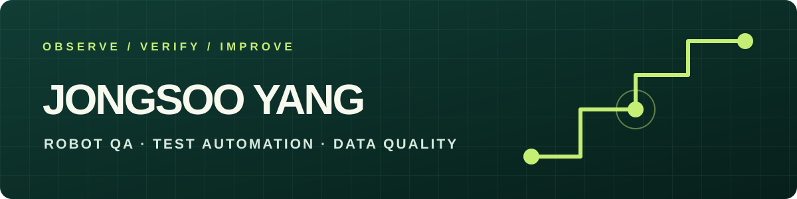

# 안녕하세요, 양종수 (Yang Jongsoo)입니다 👋

**로봇 QA · 테스트 자동화 · 데이터 품질**

로봇이 예상대로 움직이는지 확인하고, 드물게 나타나는 문제를 다시 찾을 수 있는 근거로 바꾸는 일을 해왔습니다. 로보티즈에서 액추에이터 품질 검사를, 유진로봇에서 AMR 기능 검증을 경험했습니다. 반복 테스트를 자동화하고 결과의 한계까지 기록하는 데 관심이 있습니다.

## 제가 해온 일

| 기간 | 경험 | 주로 한 일 |
| --- | --- | --- |
| 2023.01–2024.09 | **유진로봇 · AMR QA** | 도킹·맵 작성·속도 제어·장애물 회피 검증, 테스트 케이스 개선, 로그와 재현 조건 정리 |
| 2019.03–2022.12 | **로보티즈 · 액추에이터 품질** | Dynamixel Pro 조립·성능·소음 검사, 가공품 품질 확인, 테스트 환경 개선 |

- **반복 검증 자동화:** Python과 Selenium으로 관제 웹 화면의 반복 작업을 자동화해 드물게 발생하는 위치 오차를 확인했습니다.
- **측정 환경 개선:** 소음 검사의 주변 환경 영향을 줄이고, 레이저 센서를 이용한 속도 측정을 자동화했습니다.
- **협업 가능한 기록:** 장애 로그, 재현 방법, 빈도와 영상을 모아 Jira·Confluence에서 개발팀과 공유했습니다.

## 공개 프로젝트

### [Sleep AI — 수면 단계 분류와 신호 품질 검증](https://github.com/ParsleyOnLibra/sleep-ai-project)

공개 EEG 데이터로 수면 단계를 분류하고, **전체 정확도뿐 아니라 N1 오류와 입력 신호 품질**을 따로 확인한 개인 연구입니다. 품질 검사를 통과한 평가 구간 4,275개에서 Accuracy 95.42%, Macro F1 85.98%를 기록했지만, Wake→N1 전환은 기준 사건 20건 중 4건만 탐지했습니다. 좋은 수치 뒤에 남은 한계를 함께 공개했습니다.

### [부동산·주가 비교 웹 실험](https://github.com/ParsleyOnLibra/property-simulator-portfolio)

부동산과 주가의 흐름을 비교해 보기 위해 만든 개인 웹 프로젝트입니다. 현재 공개 저장소의 설명을 정리하고 있습니다.

## 사용해 본 도구와 관심사

`Python` · `Selenium` · `Jira` · `Confluence` · `Linux / Ubuntu` · `AMR 테스트` · `데이터 품질 검증`

- **자격:** ISTQB CTFL (2026), 정보처리산업기사 (2026)
- **관심:** 로봇 QA, 재현 가능한 테스트, 자동화, 수면 데이터 분석

> 전체 정확도가 좋아 보여도 실제로 놓친 장면은 없는지 확인하려고 합니다.

프로젝트의 과정과 한계는 각 저장소 README에 적었습니다.
