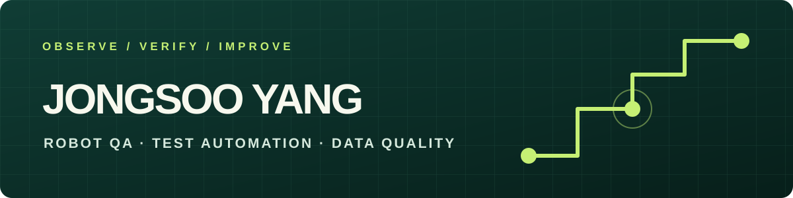

# 안녕하세요, 양종수 (Jongsoo Yang)입니다 👋

**로봇 QA · 테스트 자동화 · 시뮬레이션 QA**

로봇이 예상대로 움직이는지 확인하고, 드물게 나타나는 문제를 다시 찾을 수 있는 근거로 바꾸는 일을 해왔습니다. 로보티즈에서 액추에이터 품질 검사를, 유진로봇에서 AMR 기능 검증을 경험했습니다. 반복 테스트를 자동화하고 결과의 한계까지 기록하는 데 관심이 있습니다.

## 제가 해온 일

| 기간 | 경험 | 주로 한 일 |
| --- | --- | --- |
| 2023.01–2024.08 | **유진로봇 · AMR QA** | 도킹·맵 작성·속도 제어·장애물 회피 검증, 테스트 케이스 개선, 로그와 재현 조건 정리 |
| 2019.03–2022.11 | **로보티즈 · 액추에이터 품질** | Dynamixel Pro 조립·성능·소음 검사, 가공품 품질 확인, 테스트 환경 개선 |

- **반복 검증 자동화:** Python과 Selenium으로 관제 웹 화면의 반복 작업을 자동화해 드물게 발생하는 위치 오차를 확인했습니다.
- **측정 환경 개선:** 소음 검사의 주변 환경 영향을 줄이고, 레이저 센서를 이용한 속도 측정을 자동화했습니다.
- **협업 가능한 기록:** 장애 로그, 재현 방법, 빈도와 영상을 모아 Jira·Confluence에서 개발팀과 공유했습니다.

## 공개 프로젝트

전체 사례는 [로봇 QA 사례 모음](https://parsleyonlibra.github.io/ParsleyOnLibra/projects/robot-qa-portfolio/)에 있습니다. 프로젝트마다 제가 정한 것과 AI 도구가 만든 것을 나눠 적었고, 확인되지 않은 결과는 본인 경험으로 소개하지 않습니다.

### [AMR 창고 시뮬레이션 — 회귀 원인 좁히기](https://parsleyonlibra.github.io/ParsleyOnLibra/projects/robot-qa-portfolio/#case5)

ROS 2 Jazzy·Gazebo·Nav2로 만든 40 × 25 m 창고에서 주행 규칙을 더한 뒤 작업 성공률이 떨어진 회귀를, 기준선으로 돌아가 설정을 하나씩 다시 적용하는 방식으로 좁혔습니다. 결정·관찰은 본인, 구현·실행은 Claude Code입니다.

### [로봇 4대 관제 실연동 시뮬레이션](https://parsleyonlibra.github.io/ParsleyOnLibra/projects/robot-qa-portfolio/#case6)

80 × 50 m 창고에서 카트형 로봇 4대가 연습용 가상 관제 서버의 통로 허가를 받아 왕복합니다. 위치 상실·머묾·관제 결함을 기록하고 고쳐 다섯 번 시험했고, 왕복 성공은 6회 중 3회에서 18회 중 18회가 됐습니다(각 1회 운행). 규칙·시나리오·이슈 처리 방향은 본인, 관제 프로그램·시험 코드·분석은 Claude Code입니다.

### [AMR 미션·도킹 QA 테스트 랩](https://parsleyonlibra.github.io/ParsleyOnLibra/projects/amr-qa-lab/)

가상 AMR 관제 요구사항을 결정표·경계값·상태 전이로 분석해 20개 테스트케이스를 설계했습니다. 실행 결과 20/20 통과와 통제된 오류 주입 3/3 검출을 공개합니다. 오류 주입 중 발견한 테스트케이스 사전 조건의 결함도 재현·수정 기록으로 남겼습니다. 실제 제품의 테스트 결과는 아닙니다. [테스트 문서와 코드](https://github.com/ParsleyOnLibra/ParsleyOnLibra/tree/main/projects/amr-qa-lab)

### [ROS 2 학습 기록 — AMR QA 관점](https://github.com/ParsleyOnLibra/ParsleyOnLibra/tree/main/projects/ros2-learning)

AMR QA 경험을 바탕으로 노드·토픽·서비스·액션과 로봇 데이터 흐름을 공부하기 시작했습니다. 개념 노트부터 실습 코드, 실행 증거, 테스트케이스와 문제 해결 기록을 순차적으로 공개합니다. 기존 Docker 지도·주행 실행 기록이 있으며, 배터리 토픽 QA 패키지와 CI 결과는 Codex가 작성·실행한 사용자 검토 전 초안입니다.

## 사용해 본 도구와 관심사

`Python` · `Selenium` · `Jira` · `Confluence` · `Linux / Ubuntu` · `ROS 2` · `Gazebo` · `AMR 테스트`

- **자격:** ISTQB CTFL (2026), 정보처리산업기사 (2026)
- **관심:** 로봇 QA, 다중 로봇 시뮬레이션, 재현 가능한 테스트, 자동화

> 전체 정확도가 좋아 보여도 실제로 놓친 장면은 없는지 확인하려고 합니다.

프로젝트의 과정과 한계는 각 저장소 README에 적었습니다.
